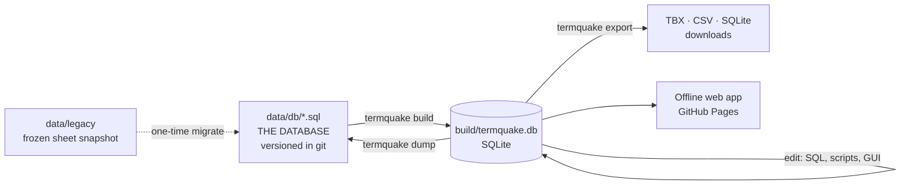

# TermQuake

Disaster-relief and search & rescue terminology for volunteer interpreters.
The database holds 31 languages; the website currently publishes **English,
Turkish and Spanish**, and works offline on any phone once opened.

**Use it:** <https://ysfztpp.github.io/TermQuake/>

TermQuake was started by translation students at Boğaziçi University after the
6 February 2023 Türkiye–Syria earthquakes and grew with volunteer translators,
interpreters and developers. The project is described in
[Akdoğan Özdemir et al. (2026), *International Journal of Disaster Risk Reduction* 146, 106498](https://doi.org/10.1016/j.ijdrr.2026.106498).

## How it works



- **The SQL database is the source of truth.** Its content lives in
  [`data/db/`](data/db/) as plain SQL, one file per table, one row per line.
  Every change is a reviewed commit, so the full history of every term is in git.
- **The old Google Sheet is no longer used.** It was migrated once on
  27 October 2026 (read-only); the snapshot is kept in [`data/legacy/`](data/legacy/).
- **Every push rebuilds and redeploys**: CI checks the database builds, is
  canonical and passes tests; the site is rebuilt, tested in a browser
  (including offline) and published to GitHub Pages.

Details: [docs/ARCHITECTURE.md](docs/ARCHITECTURE.md) ·
data model: [docs/DATA_MODEL.md](docs/DATA_MODEL.md) ·
why things are the way they are: [docs/adr/](docs/adr/) ·
current data quality: [data/QA_REPORT.md](data/QA_REPORT.md).

## Working with the data

Requirements: Python 3.11+ (and Node 20+ for the web app).

```bash
pip install -e ".[dev]"
termquake build            # data/db/*.sql -> build/termquake.db
```

Edit `build/termquake.db` any way you like:

- SQL: `sqlite3 build/termquake.db "UPDATE term SET text='enkaz' WHERE id=42"`
- a GUI such as [DB Browser for SQLite](https://sqlitebrowser.org/) (spreadsheet-like)
- a Python script (e.g. AI-assisted gap filling; see [ADR 0008](docs/adr/0008-provenance-before-ai.md))

Then save and review:

```bash
termquake dump             # build/termquake.db -> data/db/*.sql + data/QA_REPORT.md
git diff data/             # every changed row is one changed line
git commit -am "Fix Turkish term for entry 42"   # or open a pull request
```

Every edit is also recorded inside the database (`revision` table: old value,
new value, time), and saved with the data.

## Web app

```bash
termquake all              # build + downloads + site/public/data/termbase.json
cd site && npm ci && npm run dev     # http://localhost:5173
npm test && npm run typecheck
```

## Repository map

| Path | What it is |
|---|---|
| `data/db/` | **The database content** (SQL, one file per table) |
| `data/QA_REPORT.md` | Coverage per language and data-quality worklist (regenerated by `dump`) |
| `data/legacy/` | Frozen snapshot of the old Google Sheet + migration report |
| `db/` | Schema (TBX-Basic / ISO 16642 model), seed data, history triggers |
| `src/termquake/` | CLI: `build`, `dump`, `export`, `migrate`, QA checks |
| `site/` | Offline web app (Preact + TypeScript + Vite, PWA) |
| `tests/` | Pipeline tests, shared search-folding cases, browser tests |
| `termquake.toml` | Published languages, legacy sheet mapping |
| `.github/workflows/` | CI, deploy to Pages, data releases |

**Publishing another language:** add its code to `[publish] languages` in
`termquake.toml` (all 31 are already in the database), check its section of
the QA report, commit.

**Citable data version:** `git tag data-v1.0.0 && git push --tags` attaches
the database, TBX and CSV to a GitHub Release.

## Licences

- Code: [MIT](LICENSE)
- Terminology data: [CC BY-NC 4.0](LICENSE-DATA.md), © Department of Translation and
  Interpreting Studies, Boğaziçi University, and the TermQuake volunteers.

If you use TermQuake in research, please cite the article (see [CITATION.cff](CITATION.cff)).
