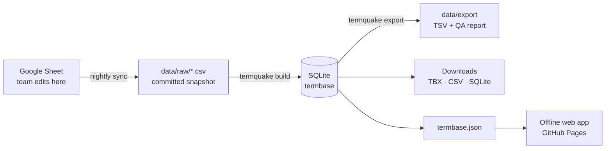

# TermQuake

Disaster-relief and search & rescue terminology for volunteer interpreters, in
**English, Turkish and Spanish** (more languages coming). Works offline on any
phone once opened.

**Use it:** <https://ysfztpp.github.io/termquake/>

TermQuake was started by translation students at Boğaziçi University after the
6 February 2023 Türkiye–Syria earthquakes and grew with volunteer translators,
interpreters and developers. The project is described in
[Akdoğan Özdemir et al. (2026), *International Journal of Disaster Risk Reduction* 146, 106498](https://doi.org/10.1016/j.ijdrr.2026.106498).

## How it works



1. **Terminologists keep editing the Google Sheet**, exactly as before.
2. Every night a GitHub Action downloads the sheet, rebuilds the database,
   checks data quality and, if anything changed, commits a dated snapshot and
   redeploys the site. Every change to the terminology is therefore recorded in
   this repository's history.
3. The site is static and fully offline after the first visit: it never
   depends on a server being up during a disaster.

Details: [docs/ARCHITECTURE.md](docs/ARCHITECTURE.md) ·
data model: [docs/DATA_MODEL.md](docs/DATA_MODEL.md) ·
why things are the way they are: [docs/adr/](docs/adr/).

## For the terminology team

- **Fix a term:** edit the Google Sheet. The site updates the next morning
  (or immediately: Actions → *Sync from Google Sheet* → *Run workflow*).
- **See what needs fixing:** [data/export/QA_REPORT.md](data/export/QA_REPORT.md)
  lists placeholders, duplicates, ambiguous separators and more, by entry number.
- **Don't** rename columns or tabs, or change the *Nr.* of an existing row:
  entry numbers are permanent IDs used in links and citations.

## For developers

Requirements: Python 3.11+, Node 20+.

```bash
pip install -e ".[dev]"      # data pipeline
termquake sync               # download the sheet into data/raw/
termquake all                # build build/termquake.db and all exports
pytest                       # pipeline tests

cd site
npm ci
npm run dev                  # web app on http://localhost:5173
npm test && npm run typecheck
```

| Path | What it is |
|---|---|
| `termquake.toml` | Sheet ID, tabs, published languages, column and domain mapping |
| `db/` | SQL schema (TBX-Basic / ISO 16642 model), seed data, history triggers |
| `src/termquake/` | Pipeline: `fetch` (sync) → `parse`/`build` (SQLite) → `export` |
| `data/raw/` | Committed snapshot of the sheet (written by the sync job) |
| `data/export/` | Committed, diff-friendly exports and the QA report |
| `site/` | Offline web app (Preact + TypeScript + Vite, PWA) |
| `tests/` | Pipeline tests, shared search-folding cases, browser tests |
| `.github/workflows/` | CI, nightly sync, deploy to Pages, data releases |

**Adding a language:** add its code to `publish.languages` in
`termquake.toml`, run `termquake all`, review its section of the QA report,
open a pull request.

**Publishing a citable data version:** `git tag data-v1.0.0 && git push --tags`.
The release workflow attaches the database, TBX and CSV files.

## Licences

- Code: [MIT](LICENSE)
- Terminology data: [CC BY-NC 4.0](LICENSE-DATA.md), © Department of Translation and
  Interpreting Studies, Boğaziçi University, and the TermQuake volunteers.

If you use TermQuake in research, please cite the article (see [CITATION.cff](CITATION.cff)).
