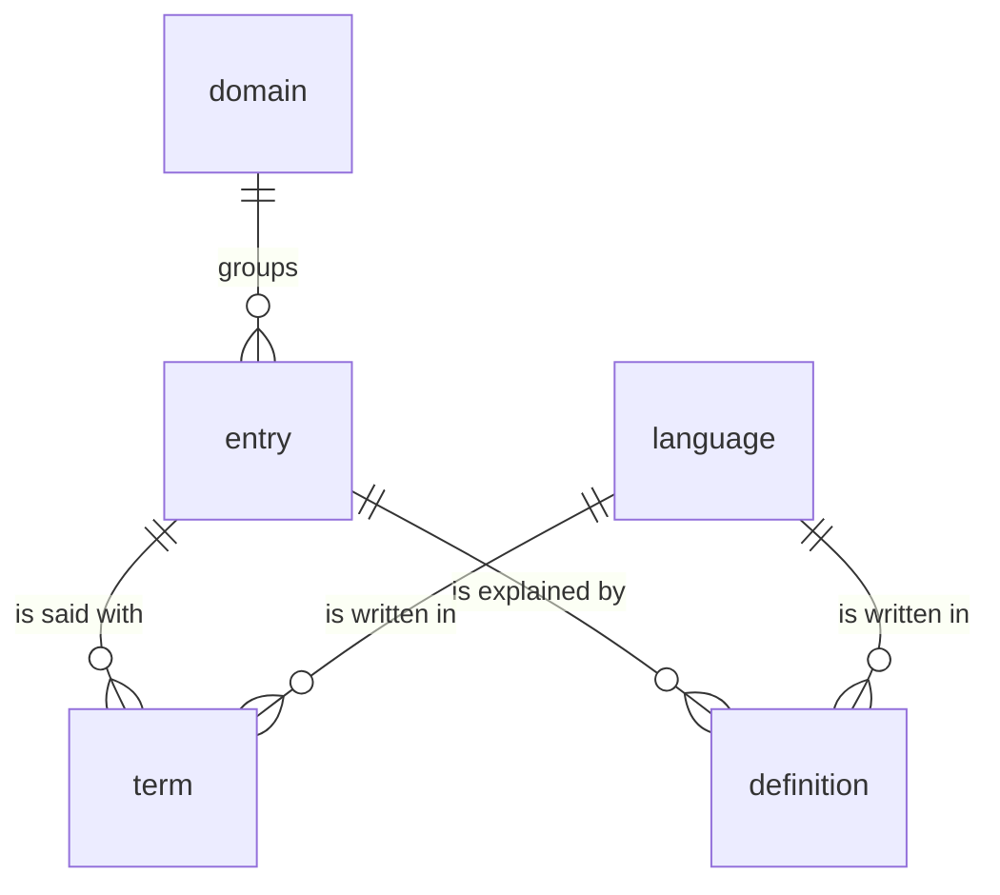
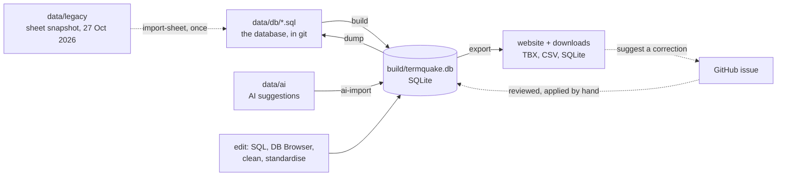

# TermQuake

Disaster-relief and search & rescue terminology in **30 languages**, for
volunteer interpreters, rescuers and survivors. The website works offline on
any phone once it has been opened.

**Use it:** <https://ysfztpp.github.io/TermQuake/>

TermQuake was started by translation students at Boğaziçi University after the
6 February 2023 Türkiye–Syria earthquakes and grew with volunteer translators,
interpreters and developers. The project is described in
[Akdoğan Özdemir et al. (2026), *International Journal of Disaster Risk Reduction* 146, 106498](https://doi.org/10.1016/j.ijdrr.2026.106498).

## What is in it

| | |
|---|---|
| Languages | 30 (Albanian has a column in the sheet but no terms yet) |
| Entries (concepts) | 523, in 6 domains |
| Terms | 17,445: **13,969 from the sheet**, 3,476 AI suggestions |
| Definitions | 153: 14 from the sheet, 139 AI suggestions |

**AI suggestions are always marked.** Gaps in the sheet were filled by an AI
model (Claude) in November 2026. No person has verified them yet. Each one is
stored with `origin = 'ai'`. The website hides them unless you switch them on
and labels them "AI suggestion, not verified". The TBX file carries the same
note, and the CSV leaves them out. Zazaki and Albanian were not filled. See
[`data/ai/README.md`](data/ai/README.md).

## The website

- Search in any of the 30 languages, ignoring accents and the Turkish dotted
  and dotless i. A typo gets a "did you mean" suggestion.
- An entry shows the chosen language pair. The other languages are in a
  section you can open.
- Full-screen mode shows a term to the person in front of you. It keeps the
  screen on and can read the term aloud.
- Domain filters, light and dark colours, and an interface in Turkish, English
  and Spanish.
- "Suggest a correction" and "Suggest a new term" open a short form. It becomes
  a GitHub issue or a text to share, and the team applies it by hand.
- Downloads: TBX (for translation tools such as MultiTerm and memoQ), CSV and
  SQLite.

## The database in one picture



Five tables. An **entry** is one meaning (one row of the original sheet). Each
**language** says it with one or more **terms**: synonyms and abbreviations are
separate rows, and the first is the main term. An entry belongs to a **domain**
and may have a **definition**. Every term and definition records its `origin`
(`sheet`, `team` or `ai`) and its `review_status`. The structure follows the
terminology standards ISO 16642 and TBX (ISO 30042). Start with
[docs/DATA_MODEL.md](docs/DATA_MODEL.md).

## How it works



- **The SQL database is the source of truth.** It lives in [`data/db/`](data/db/)
  as plain SQL: one file per table, one row per line. Every change is a commit,
  so git holds the full history of every term.
- **The Google Sheet is no longer edited.** A read-only copy was imported on
  27 October 2026; the snapshot is in [`data/legacy/`](data/legacy/).
- **Every change to `main` is checked, then published.** The database must
  build, the files must be canonical, the texts must pass the clean-up rules
  and the tests must pass. The website is then built, tested in a real browser
  and deployed. If a step fails, the live site stays as it was.

## Working with the data

You need Python 3.11+ (and Node 20+ only for the website).

```bash
pip install -e ".[dev]"
termquake build            # data/db/*.sql -> build/termquake.db
```

Open `build/termquake.db` in [DB Browser for SQLite](https://sqlitebrowser.org/)
(it looks like a spreadsheet) or use SQL. The [`queries/`](queries/) folder has
ten commented example queries: coverage, missing translations, search, and how
to add, fix or remove a term.

Then save and review:

```bash
termquake clean            # fixes stray spaces and invisible characters
termquake dump             # build/termquake.db -> data/db/*.sql
git diff data/db           # every changed row is one changed line
git commit -am "Fix the Turkish term of entry 42"   # or open a pull request
```

A term you add or correct should get `origin = 'team'`. When a speaker has
checked a term, set `review_status = 'reviewed'`.

Small fixes can also be made directly in `data/db/term.sql`, even in GitHub's
web editor: change the text between the quotes on one line.

**Two safety checks protect your work.** `termquake build` won't throw away
edits you haven't saved with `dump`. `termquake dump` won't save over changes
that reached `data/db/` after your build (a `git pull`, a hand edit). Each
message says what to do; `--force` overrides it on purpose.

**Without Python**, the database can be built with the `sqlite3` tool alone:

```bash
sqlite3 termquake.db < db/schema.sql
cat data/db/language.sql data/db/domain.sql data/db/entry.sql data/db/term.sql data/db/definition.sql | sqlite3 termquake.db
```

### All commands

| Command | Does |
|---|---|
| `termquake build` | `data/db/*.sql` → `build/termquake.db` |
| `termquake dump` | `build/termquake.db` → `data/db/*.sql` (`--check`: fail if they differ) |
| `termquake clean` | Fix spaces, invisible characters and Unicode form; never changes words (`--check` runs in CI) |
| `termquake standardise` | Split cells into one row per term (synonyms, abbreviations) |
| `termquake ai-import` | Fill gaps from `data/ai/`, marked as AI; never overwrites a term |
| `termquake review <lang>` | Write a review sheet (xlsx) for one language |
| `termquake export` | Website data and the TBX, CSV and SQLite downloads |
| `termquake all` | `build` + `export` |
| `termquake import-sheet` | Once: sheet snapshot → `data/db` (refuses to overwrite) |
| `termquake fetch-sheet` | Download a Google Sheet's tabs as CSV (read-only) |

## Website development

```bash
termquake all                         # build + downloads + website data
cd site && npm ci && npm run dev      # http://localhost:5173
npm test && npm run typecheck
```

## Repository map

| Path | What it is |
|---|---|
| `db/schema.sql` | **The tables**, with a comment on every column |
| `data/db/` | **The data**, one SQL file per table |
| `data/ai/` | AI suggestions (terms, definitions) and how they were made |
| `data/review/` | Review rules' suggestions for the language-by-language review |
| `data/legacy/` | Frozen snapshot of the Google Sheet + import report |
| `queries/` | Example queries for learning and checking the data |
| `docs/` | Data model, architecture, decision records (`adr/`) |
| `src/termquake/` | The `termquake` command (see above) |
| `site/` | The offline website (Preact + TypeScript + Vite) |
| `tests/` | Tests for the data tools, the queries and the website |
| `termquake.toml` | The original sheet's id, tabs and domain names |
| `.github/workflows/` | Checks, deployment to GitHub Pages, data releases |

Earlier versions are kept on branches:
[`legacy`](https://github.com/ysfztpp/TermQuake/tree/legacy) is the site and
data before the 11 November 2026 update (data exactly as typed, no AI), and
[`archive/v0.1.1-full-schema`](https://github.com/ysfztpp/TermQuake/tree/archive/v0.1.1-full-schema)
is the first, larger design (16 tables).

**Citable data version:** `git tag data-v1.0.0 && git push --tags` attaches the
database, TBX and CSV to a GitHub Release.

## Licences

- Code: [MIT](LICENSE)
- Terminology data: [CC BY-NC 4.0](LICENSE-DATA.md), © Department of Translation and
  Interpreting Studies, Boğaziçi University, and the TermQuake volunteers.
  AI suggestions are marked as such and have not been verified.

If you use TermQuake in research, please cite the article (see [CITATION.cff](CITATION.cff)).
