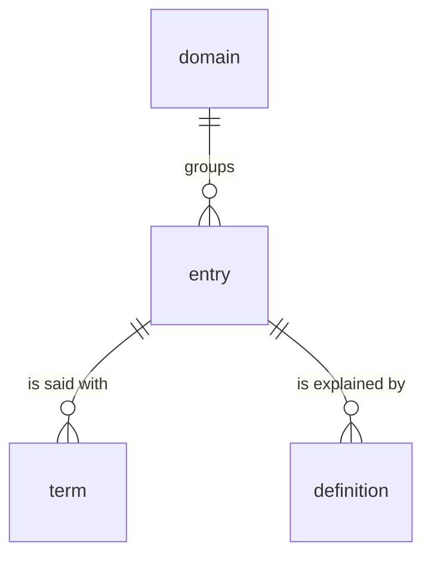
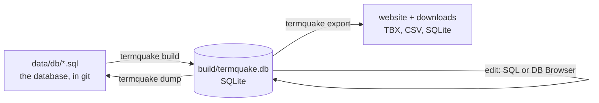

# TermQuake

Disaster-relief and search & rescue terminology in **English, Turkish and
Spanish**, for volunteer interpreters, rescuers and survivors. The website works
offline on any phone once it has been opened.

**Use it:** <https://ysfztpp.github.io/TermQuake/>

TermQuake was started by translation students at Boğaziçi University after the
6 February 2023 Türkiye–Syria earthquakes and grew with volunteer translators,
interpreters and developers. The project is described in
[Akdoğan Özdemir et al. (2026), *International Journal of Disaster Risk Reduction* 146, 106498](https://doi.org/10.1016/j.ijdrr.2026.106498).

## The database in one picture



Four tables: an **entry** is one meaning (one row of the original sheet); each
language says it with a **term**; an entry belongs to a **domain** and may have
a **definition**. 523 entries, 1,502 terms, 14 definitions, exactly as typed in
the sheet. Start with [docs/DATA_MODEL.md](docs/DATA_MODEL.md).

## How it works



- **The SQL database is the source of truth.** It lives in [`data/db/`](data/db/)
  as plain SQL: one file per table, one row per line. Every change is a commit,
  so git holds the full history of every term.
- **The Google Sheet is no longer edited.** It was imported once, read-only, on
  27 October 2026; the snapshot is in [`data/legacy/`](data/legacy/).
- **Every change to `main` is checked, then published.** The database must
  build, the files must be canonical and the tests must pass; the website is
  then built, tested in a real browser and deployed. If a step fails, the live
  site stays as it was.

## Working with the data

You need Python 3.11+ (and Node 20+ only for the website).

```bash
pip install -e ".[dev]"
termquake build            # data/db/*.sql -> build/termquake.db
```

Open `build/termquake.db` in [DB Browser for SQLite](https://sqlitebrowser.org/)
(it looks like a spreadsheet) or use SQL. The [`queries/`](queries/) folder has
ten commented example queries: coverage, missing translations, search, and how
to add, fix or remove a term.

Then save and review:

```bash
termquake dump             # build/termquake.db -> data/db/*.sql
git diff data/db           # every changed row is one changed line
git commit -am "Fix the Turkish term of entry 42"   # or open a pull request
```

Small fixes can also be made directly in `data/db/term.sql`, even in GitHub's
web editor: change the text between the quotes on one line.

**Two safety checks protect your work.** `termquake build` won't throw away
edits you haven't saved with `dump`. `termquake dump` won't save over changes
that reached `data/db/` after your build (a `git pull`, a hand edit). Each
message says what to do; `--force` overrides it on purpose.

**Without Python**, the database can be built with the `sqlite3` tool alone:

```bash
sqlite3 termquake.db < db/schema.sql
cat data/db/domain.sql data/db/entry.sql data/db/term.sql data/db/definition.sql | sqlite3 termquake.db
```

## Website

```bash
termquake all                         # build + downloads + website data
cd site && npm ci && npm run dev      # http://localhost:5173
npm test && npm run typecheck
```

## Repository map

| Path | What it is |
|---|---|
| `db/schema.sql` | **The tables**, with a comment on every column |
| `data/db/` | **The data**, one SQL file per table |
| `queries/` | Example queries for learning and checking the data |
| `data/legacy/` | Frozen snapshot of the Google Sheet + import report |
| `docs/` | Data model, architecture, decision records (`adr/`) |
| `src/termquake/` | The `termquake` command: build, dump, export, import-sheet |
| `site/` | The offline website (Preact + TypeScript + Vite) |
| `tests/` | Tests for the data tools, the queries and the website |
| `termquake.toml` | Languages and the sheet's column mapping |
| `.github/workflows/` | Checks, deployment to GitHub Pages, data releases |

The earlier, larger version (16 tables, 30 languages) is kept on the branch
[`archive/v0.1.1-full-schema`](https://github.com/ysfztpp/TermQuake/tree/archive/v0.1.1-full-schema).

**Citable data version:** `git tag data-v1.0.0 && git push --tags` attaches the
database, TBX and CSV to a GitHub Release.

## Licences

- Code: [MIT](LICENSE)
- Terminology data: [CC BY-NC 4.0](LICENSE-DATA.md), © Department of Translation and
  Interpreting Studies, Boğaziçi University, and the TermQuake volunteers.

If you use TermQuake in research, please cite the article (see [CITATION.cff](CITATION.cff)).
