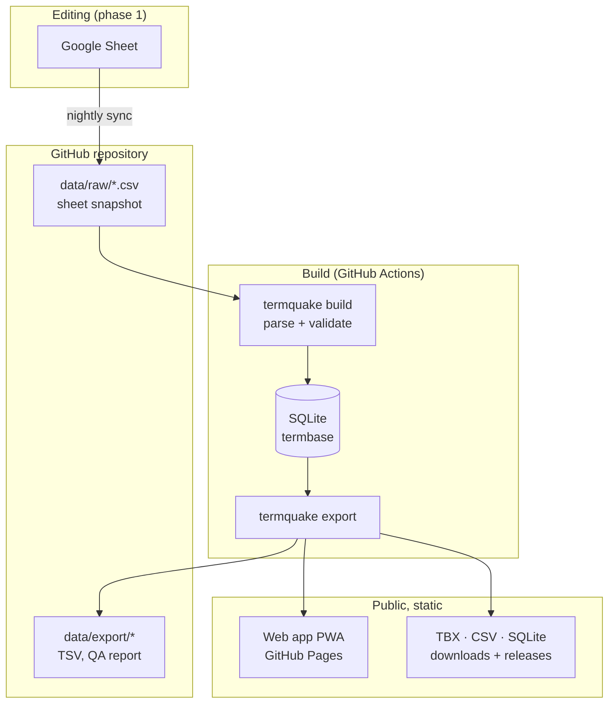

# Architecture

## Requirements this design answers

From the TermQuake article and the field experience behind it:

1. **Works when infrastructure doesn't.** Field interpreters may have no
   signal and little battery. The resource must work offline.
2. **Volunteers keep contributing** in a tool they already know (the Google
   Sheet), while the data moves to a structured, standard form.
3. **Every change is traceable**: who/what changed, when, and the ability to
   cite a fixed version in research.
4. **Interoperable**: translators can load it into CAT tools (TBX), researchers
   can query it (SQL), anyone can open it (CSV).
5. **Ready for AI-assisted gap filling** without ever passing machine output
   off as human-verified.
6. **Maintainable by students** who rotate every year: no servers to patch,
   no paid services, everything reproducible from the repository.

## Overview

### Stages

| Stage | Command | Input → output | Deterministic? |
|---|---|---|---|
| Sync | `termquake sync` | Google Sheet (xlsx export) → `data/raw/*.csv` | No (network) |
| Build | `termquake build` | `data/raw` → `build/termquake.db` | Yes |
| Export | `termquake export` | database → `data/export`, downloads, `termbase.json` | Yes |
| Site | `npm run build` | `termbase.json` + app → `site/dist` | Yes |

Separating the one non-deterministic step (the download) from everything else
means every build can be reproduced exactly from a commit, and tests run
without network access.

## Versioning, three layers

1. **Git history of `data/raw` and `data/export`.** The nightly job commits
   only when the sheet changed, with a dated message and a per-language summary.
   `git log -p data/export/terms.tr.tsv` shows every Turkish change ever made.
   Exports are sorted and timestamp-free, so diffs show real changes only.
2. **Data releases.** A tag `data-vX.Y.Z` publishes the database, TBX and CSV
   as a GitHub Release, a fixed version that can be cited (add Zenodo for a DOI).
3. **Row-level revision log in the database** (`revision` table, filled by
   triggers). Inactive while the sheet is the source of truth (the database is
   rebuilt each time); it becomes the edit history in phase 2.

## Hosting and security

- **GitHub Pages**, static files only: no server, no database to attack or keep
  alive, free, with HTTPS.
- **Offline**: a service worker (Workbox) precaches the app and all terms on the
  first visit (about 190 KB). New data is offered with a "Load update" prompt,
  never forced mid-lookup.
- **Content-Security-Policy** allows only same-origin resources; fonts are
  self-hosted, there are no trackers or third-party scripts.
- **No secrets**: the sheet is public, so sync uses the plain xlsx export.
- **Safety nets**: a broken sheet fails the build (nothing published); a drop
  of more than 10% of entries stops the sync until a person confirms it.

## Phases

**Phase 1 (now).** Sheet → snapshot → SQLite → static site. Three pilot
languages: en, tr, es.

**Phase 2 (when editing moves off the sheet).** The same schema runs on
PostgreSQL (e.g. Supabase): contributor logins, the voting workflow
(`review_vote`, +2 rule) and the revision log go live; the importer runs once as
a migration. The public site stays static and is regenerated from the database,
so the public tool never depends on that server.

**Phase 3 (data work).** Standardisation and AI gap-filling, written into the
database with `origin = 'mt' | 'llm'`, `review_status = 'proposed'`, and shown
on the site only after human approval. See [DATA_MODEL.md](DATA_MODEL.md).
