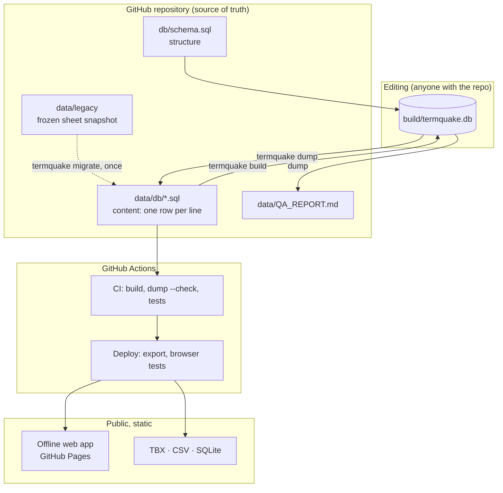

# Architecture

## Requirements this design answers

From the TermQuake article and the field experience behind it:

1. **Works when infrastructure doesn't.** Field interpreters may have no
   signal and little battery. The public tool must work offline.
2. **A real, structured SQL database** following terminology standards,
   instead of a spreadsheet.
3. **Every change is traceable**: what changed, when, by whom, and fixed
   versions that can be cited in research.
4. **Interoperable**: translators load it into CAT tools (TBX), researchers
   query it (SQL), anyone opens it (CSV).
5. **Ready for AI-assisted gap filling** without passing machine output off as
   human-verified.
6. **Maintainable by students** who rotate every year: no servers to patch,
   no paid services, everything reproducible from the repository.

## Overview

### Commands

| Command | Does | Writes |
|---|---|---|
| `termquake build` | Creates the SQLite database from schema + `data/db`, installs history triggers, runs QA checks | `build/termquake.db` |
| `termquake dump` | Saves the (edited) database back as canonical SQL, refreshes the QA report | `data/db/*.sql`, `data/QA_REPORT.md` |
| `termquake dump --check` | Fails if the committed files are not exactly what `dump` would write | nothing |
| `termquake export` | Publishes downloads and web app data | `site/public/…` |
| `termquake migrate` | One-time: legacy sheet snapshot → `data/db` (refuses to overwrite) | `data/db`, `data/legacy/MIGRATION_REPORT.md` |

### Why the database lives in git as SQL text

A hosted database server (PostgreSQL on Supabase, say) is the right tool once
many people edit at the same time through a web form. Until then it adds an
account, a server that free tiers pause after a week of inactivity, backups to
manage, and a way for the public site to go down. Keeping the database as SQL
text in git gives, at no cost:

- **history and blame for every row**: `git log -p data/db/term.sql`;
- **review before publishing**: changes arrive as pull requests, CI checks them;
- **backups and replicas**: every clone is a full copy;
- **portability**: the same schema and SQL load into PostgreSQL when phase 2 needs it.

The built SQLite file is a working copy, like a compiled program: it's never
committed, and it's rebuilt from `data/db` in under a second.

## Versioning, three layers

1. **Git history of `data/db/`**: every saved change, with author, date and
   message. Files are sorted and one row per line, so diffs show exactly the
   rows that changed.
2. **The `revision` table**: database triggers record old and new values of
   every term and definition change, saved with the data. History survives a
   later move to PostgreSQL.
3. **Data releases**: a tag `data-vX.Y.Z` publishes the database, TBX and CSV
   as a GitHub Release, a fixed version for citation (add Zenodo for a DOI).

## Hosting and security

- **GitHub Pages**, static files only: no server, no database to attack or keep
  alive, free, HTTPS.
- **Offline**: a service worker precaches the app and all published terms on
  the first visit (about 190 KB). New data is offered with a "Load update"
  prompt, never forced mid-lookup.
- **Content-Security-Policy** allows only same-origin resources; fonts are
  self-hosted; no trackers or third-party scripts.
- **No secrets** anywhere in the repository or workflows.
- **Nothing reaches the public site unless** the database builds, the
  committed files are canonical, all tests pass, and the built site passes
  browser tests (search, deep links, full-screen view, offline).

## Phases

**Now.** SQL database in git (31 languages; en, tr, es published), static
offline site, CI/CD. Edits via SQL, scripts or a database GUI, then `dump`.

**Next: data work.** Standardise legacy entries (resolve the QA worklist) and
fill gaps with machine translation / LLMs, written with `origin = 'mt' | 'llm'`
and `review_status = 'proposed'`, published only after human approval.

**Later, if many volunteers need to edit at once:** load the same schema into
PostgreSQL (e.g. Supabase) with logins and the voting workflow
(`review_vote`, approval at +2), and keep exporting `data/db` to git nightly
for history and for the static site. The public tool still never depends on
that server.
