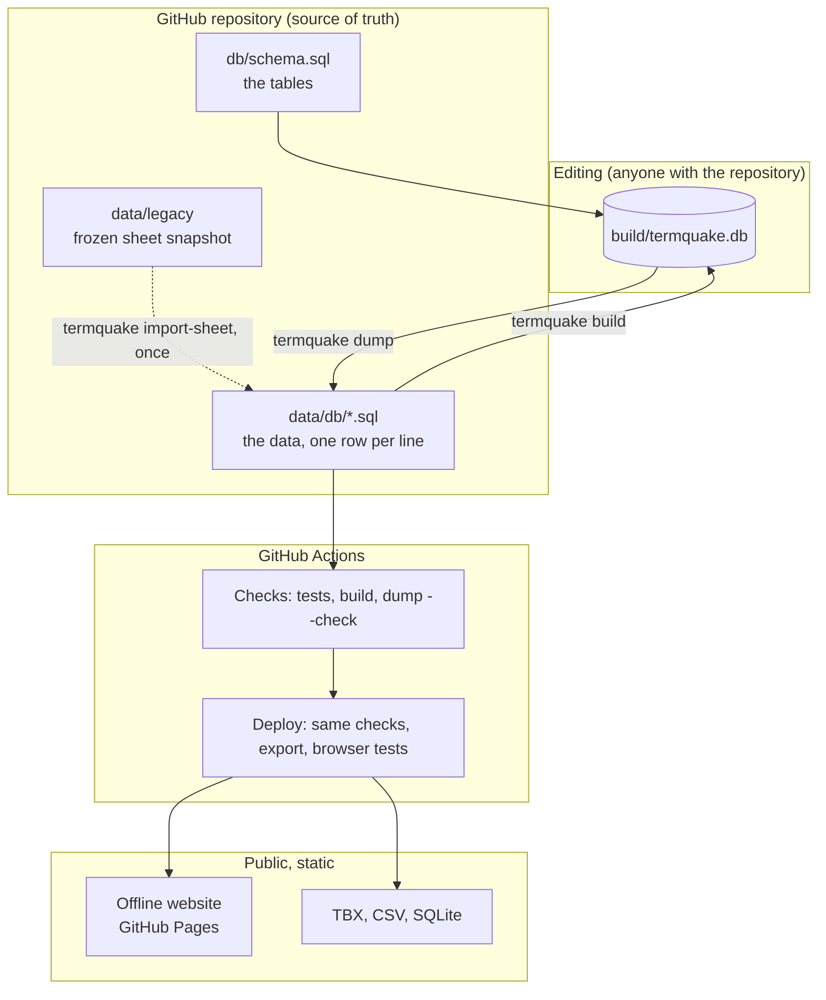

# Architecture

## Requirements this design answers

From the TermQuake article and the field experience behind it:

1. **Works when infrastructure doesn't.** Field interpreters may have no
   signal and little battery. The public tool must work offline.
2. **A real, structured SQL database** following terminology standards,
   instead of a spreadsheet, and simple enough to teach.
3. **Every change is traceable**: what changed, when, by whom, and fixed
   versions that can be cited in research.
4. **Interoperable**: translators load it into CAT tools (TBX), researchers
   query it (SQL), anyone opens it (CSV).
5. **Maintainable by students** who rotate every year: no servers to patch,
   no paid services, everything reproducible from the repository.

## Overview

### Commands

| Command | Does | Writes |
|---|---|---|
| `termquake build` | Creates the SQLite database from `db/schema.sql` + `data/db`. Refuses to discard edits not yet dumped (`--force` overrides) | `build/termquake.db` |
| `termquake dump` | Saves the (edited) database back as canonical SQL. Refuses if `data/db` changed since the build (`--force` overrides) or a reference is broken | `data/db/*.sql` |
| `termquake dump --check` | Fails if the committed files are not exactly what `dump` would write | nothing |
| `termquake export` | Writes the downloads and the website data | `site/public/…` |
| `termquake import-sheet` | Once: sheet snapshot → `data/db` (refuses to overwrite) | `data/db`, `data/legacy/IMPORT_REPORT.md` |

### Why the database lives in git as SQL text

A hosted database server (PostgreSQL on Supabase, say) is the right tool once
many people edit at the same time through a web form. Until then it adds an
account, a server that free tiers pause after a week of inactivity, backups to
manage, and a way for the public site to go down. Keeping the database as SQL
text in git gives, at no cost:

- **history and blame for every row**: `git log -p data/db/term.sql`;
- **review before publishing**: changes arrive as pull requests, CI checks them;
- **backups**: every clone is a full copy;
- **portability**: the same schema and SQL load into PostgreSQL if ever needed.

The built SQLite file is a working copy, like a compiled program: it is never
committed and is rebuilt from `data/db` in a fraction of a second. A small
fingerprint file next to it (`build/termquake.db.json`) records what it was
built from, which is how `build` and `dump` notice when one would overwrite
the other's changes.

## Versioning

1. **Git history of `data/db/`**: every saved change, with author, date and
   message. Files are sorted and one row per line, so a diff shows exactly the
   rows that changed.
2. **Data releases**: a tag `data-vX.Y.Z` publishes the database, TBX and CSV
   as a GitHub Release, a fixed version for citation (connect Zenodo for a DOI).
3. **Code versions**: the earlier 16-table design is kept on the branch
   `archive/v0.1.1-full-schema`.

## Website

- **Data:** `termquake export` writes one JSON file with the three languages
  (about 60 KB). The site shows each cell without surrounding spaces; the
  database keeps them as typed.
- **Search** ignores case, accents and Turkish dotless/dotted i, so "sargi"
  finds "sargı bezi" without a Turkish keyboard.
- **Phones first:** the long list renders in batches of 60 as you scroll;
  buttons and filters are at least 40 px tall; the full-screen view keeps the screen on.
  Lighthouse (mobile): performance 99, accessibility 100, best practices 100,
  SEO 100.

## Hosting and security

- **GitHub Pages**, static files only: no server, no database to attack or
  keep alive, free, HTTPS.
- **Offline**: a service worker caches the app and all terms on the first
  visit. New data is offered with a "Load update" prompt, never forced
  mid-lookup.
- **Content-Security-Policy** allows only same-origin resources; fonts are
  self-hosted; no trackers or third-party scripts.
- **No secrets** anywhere in the repository or workflows.
- **Nothing reaches the public site unless** the tests pass, the database
  builds, the files are canonical and the built site passes browser tests
  (search, deep links, full-screen view, offline). The deploy workflow runs
  these checks itself.
- **First deploy in a new repository**: Settings → Pages → Source:
  "GitHub Actions".

## Growing later

The four tables are a starting point, not a ceiling. Each later need adds a
column or a table through a schema change (raise `SCHEMA_VERSION`, update
`db/schema.sql`, migrate the data, review the diff):

- **Splitting synonyms** (`enkaz / moloz` into two terms): allow several terms
  per language and add an order column ([ADR 0010](adr/0010-four-tables-raw-data.md)).
- **AI-assisted gap filling**: add `origin` and `review_status` to `term` and
  `definition` first, so machine output is never published unreviewed
  ([ADR 0008](adr/0008-provenance-before-ai.md)).
- **Many editors at once**: load the same schema into PostgreSQL with logins
  and keep exporting to git for history and the static site.
