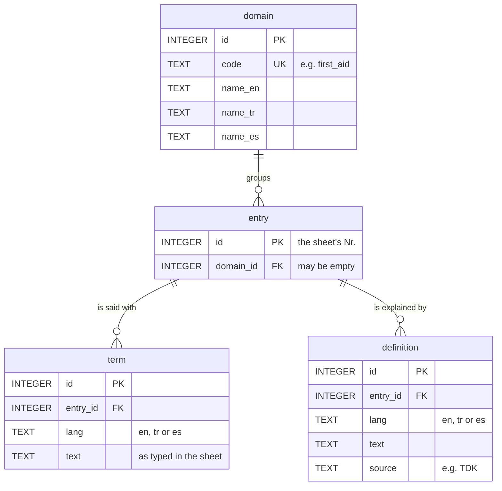

# Data model

The database has **four tables** and follows one idea used by every
professional termbase (ISO 16642, TBX): an **entry** is one meaning, and each
language says it with a **term**.



The full definitions, with comments, are in [`db/schema.sql`](../db/schema.sql).

## The tables

| Table | One row is | Rows today | Columns |
|---|---|---:|---|
| `domain` | a value of the sheet's Domain column | 6 | `id`, `code`, `name_en`, `name_tr`, `name_es` |
| `entry` | one meaning (one row of the sheet) | 523 | `id` (the sheet's Nr.), `domain_id` |
| `term` | what one language calls an entry (one cell of the sheet) | 1,502 | `id`, `entry_id`, `lang`, `text` |
| `definition` | what an entry means in one language | 14 | `id`, `entry_id`, `lang`, `text`, `source` |

Plus one **view**, `entry_overview`: a saved query that shows the data the way
the sheet did, one row per entry with `en`, `tr` and `es` columns. A view stores
nothing; it is computed each time it is opened.

### Why split the sheet into tables?

The sheet had one row per meaning and one column per language. As tables:

- `entry` holds what is true of the meaning in every language (its number, its domain);
- `term` holds what differs per language (the words).

This is **normalisation**: each fact is stored once. A new language needs new
rows, not a new column, and "every Spanish term" is one simple query.

### Example: entry 5

```sql
SELECT lang, text FROM term WHERE entry_id = 5;
```

| lang | text |
|---|---|
| en | debris / rubble |
| tr | enkaz / moloz |
| es | escombros |

The same rows in the file git stores (`data/db/term.sql`), one line per row:

```sql
INSERT INTO term (id, entry_id, lang, text) VALUES (13, 5, 'en', 'debris / rubble');
INSERT INTO term (id, entry_id, lang, text) VALUES (14, 5, 'tr', 'enkaz / moloz');
INSERT INTO term (id, entry_id, lang, text) VALUES (15, 5, 'es', 'escombros');
```

## The rules the database enforces

These make it a database rather than a spreadsheet: wrong data is refused
when someone tries to save it.

| Rule | SQL | What it prevents |
|---|---|---|
| Every row has a unique number | `id INTEGER PRIMARY KEY` | two rows that cannot be told apart |
| A term belongs to an entry that exists | `REFERENCES entry(id)` (foreign key) | orphan terms |
| A term has a language and a text | `NOT NULL`, `CHECK (trim(text) <> '')` | blank cells saved as terms |
| Only the project's languages | `CHECK (lang IN ('en', 'tr', 'es'))` | typos such as `'TR'` or `'tur'` |
| One cell per entry and language | `UNIQUE (entry_id, lang)` | the same cell entered twice |
| A domain in use cannot be deleted | `ON DELETE RESTRICT` | entries pointing to nothing |
| Deleting an entry deletes its terms | `ON DELETE CASCADE` | leftover terms of a removed entry |

SQLite checks foreign keys only when `PRAGMA foreign_keys = ON`. The
`termquake` tools always switch it on; DB Browser for SQLite does too by default.

## Conventions (industry practice)

- Table names are singular and in snake_case: `term`, not `Terms`.
- Every table has an integer primary key called `id`.
- A column that points to another table is named `<table>_id` and is a foreign key.
- Foreign keys have an index (`entry_domain_id_idx`); `UNIQUE` constraints create their own.
- Languages use BCP 47 codes: `en`, `tr`, `es`.
- The schema has a version number (`PRAGMA user_version = 2`), raised whenever the tables change.
- Every column has a comment in `db/schema.sql` saying what it holds.

## The data is exactly as typed

The data was imported from the sheet without changes ([ADR 0010](adr/0010-four-tables-raw-data.md)):

- a cell with several synonyms, such as `enkaz / moloz`, is one term row;
- spaces at the start or end of a cell, and an `i` written as `i` + combining dot, are kept;
- only spreadsheet placeholders (`#empty1`, `#empty2`, `#empty3`) were left out.

[`data/legacy/IMPORT_REPORT.md`](../data/legacy/IMPORT_REPORT.md) lists these
cases and the queries in [`queries/`](../queries/) find them. Cleaning them up
is the team's decision, made in the database and reviewed in git.

The website shows each cell without the spaces around it. That is display
only; the database is not changed.

## Mapping to TBX (the ISO exchange format)

TBX-Basic requires only two things in an entry: the term and its language;
the rest is recommended. The download `termquake.tbx` maps as follows:

| TBX | TermQuake |
|---|---|
| `conceptEntry` | `entry` (id `tq5` for entry 5) |
| `descrip type="subjectField"` | `domain.name_en` |
| `langSec xml:lang` | `term.lang` |
| `termSec / term` | `term.text` |
| `descrip type="definition"` + `admin type="source"` | `definition.text`, `definition.source` |
| `termNote type="termType"` = `phrase` | entries in the Expressions domain |

TBX defines files for exchanging terminology, not how a database must be laid
out inside, so a small database is fully compatible with it.

## What is deliberately not in the database (yet)

| Not here | Why | When it comes back |
|---|---|---|
| The other 27 languages | out of scope for now | they stay in `data/legacy/terms.csv` and on the branch `archive/v0.1.1-full-schema` |
| A change-history table | git already records every change, by whom and why | not needed |
| Votes, contributors | there is no editing website; changes go through GitHub | if an editing website is built |
| Who wrote a term (`origin`) and its review status | every term comes from the sheet | before AI-generated terms are added (roadmap phase 3) |
| Part of speech, gender, usage status | nobody fills them yet | when the team standardises entries |
