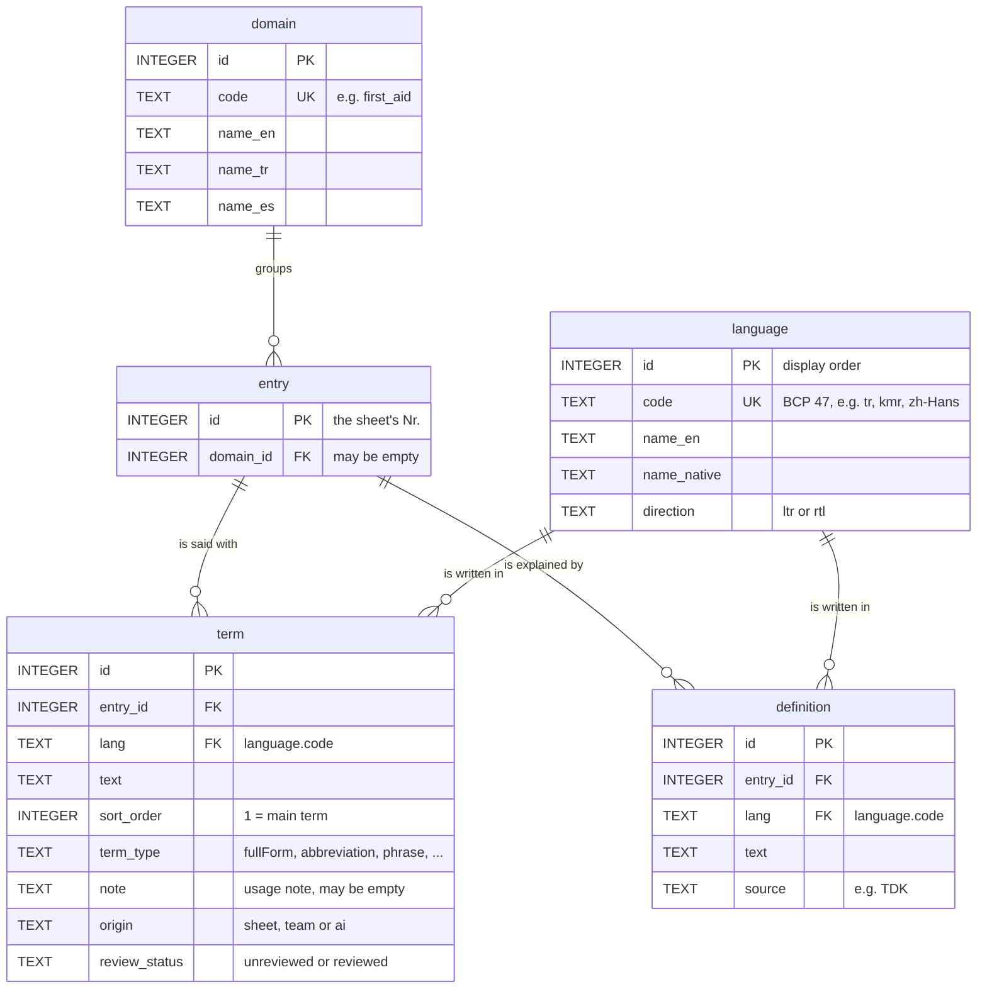

# Data model

The database has **five tables** and follows one idea used by every
professional termbase (ISO 16642, TBX): an **entry** is one meaning, and each
language says it with a **term**.



The full definitions, with comments, are in [`db/schema.sql`](../db/schema.sql).

## The tables

| Table | One row is | Rows today | Columns |
|---|---|---:|---|
| `language` | a language of the termbase (a language column of the sheet) | 31 | `id`, `code`, `name_en`, `name_native`, `direction` |
| `domain` | a value of the sheet's Domain column | 6 | `id`, `code`, `name_en`, `name_tr`, `name_es` |
| `entry` | one meaning (one row of the sheet) | 523 | `id` (the sheet's Nr.), `domain_id` |
| `term` | one way a language says an entry (synonyms and abbreviations are separate rows) | 12,415 | `id`, `entry_id`, `lang`, `text`, `sort_order`, `term_type`, `note`, `origin`, `review_status` |
| `definition` | what an entry means in one language | 14 | `id`, `entry_id`, `lang`, `text`, `source` |

Plus one **view**, `entry_overview`: a saved query that shows the data the way
the sheet did, one row per entry with one column per language (`en`, `tr`, `es`, `de`, ...). A view stores
nothing; it is computed each time it is opened.

### Why split the sheet into tables?

The sheet had one row per meaning and one column per language. As tables:

- `entry` holds what is true of the meaning in every language (its number, its domain);
- `term` holds what differs per language (the words).

This is **normalisation**: each fact is stored once. A new language needs new
rows, not a new column, and "every Spanish term" is one simple query.

### Example: entry 5

```sql
SELECT lang, text FROM term WHERE entry_id = 5;
```

| lang | text |
|---|---|
| en | debris / rubble |
| tr | enkaz / moloz |
| es | escombros |
| de | Trümmer / Schutt |
| ... | (one row per language that has a term) |

The same rows in the file git stores (`data/db/term.sql`), one line per row:

```sql
INSERT INTO term (id, entry_id, lang, text, sort_order, term_type, note, origin, review_status) VALUES (13, 5, 'en', 'debris / rubble', 1, 'fullForm', NULL, 'sheet', 'unreviewed');
INSERT INTO term (id, entry_id, lang, text, sort_order, term_type, note, origin, review_status) VALUES (14, 5, 'tr', 'enkaz / moloz', 1, 'fullForm', NULL, 'sheet', 'unreviewed');
INSERT INTO term (id, entry_id, lang, text, sort_order, term_type, note, origin, review_status) VALUES (15, 5, 'es', 'escombros', 1, 'fullForm', NULL, 'sheet', 'unreviewed');

When the English review splits `debris / rubble`, the first row becomes
`debris` (sort_order 1) and a new row `rubble` (sort_order 2) is added.
```

## The rules the database enforces

These make it a database rather than a spreadsheet: wrong data is refused
when someone tries to save it.

| Rule | SQL | What it prevents |
|---|---|---|
| Every row has a unique number | `id INTEGER PRIMARY KEY` | two rows that cannot be told apart |
| A term belongs to an entry that exists | `REFERENCES entry(id)` (foreign key) | orphan terms |
| A term has a language and a text | `NOT NULL`, `CHECK (trim(text) <> '')` | blank cells saved as terms |
| Only languages in the `language` table | `lang REFERENCES language(code)` | typos such as `'TR'` or `'tur'` |
| A language in use cannot be deleted | `ON DELETE RESTRICT` | terms in a language that no longer exists |
| Writing direction is left-to-right or right-to-left | `CHECK (direction IN ('ltr', 'rtl'))` | values the website cannot use |
| A term appears once per entry and language | `UNIQUE (entry_id, lang, text)` | the same term entered twice |
| Each term has its own place in the order | `UNIQUE (entry_id, lang, sort_order)`, `CHECK (sort_order >= 1)` | two "main" terms |
| Term types are the TBX ones | `CHECK (term_type IN ('fullForm', 'abbreviation', 'acronym', 'shortForm', 'variant', 'phrase'))` | made-up types tools cannot read |
| Where a term came from is known | `CHECK (origin IN ('sheet', 'team', 'ai'))` | AI text that looks like human text |
| Review status is one of two values | `CHECK (review_status IN ('unreviewed', 'reviewed'))` | free-text statuses |
| A domain in use cannot be deleted | `ON DELETE RESTRICT` | entries pointing to nothing |
| Deleting an entry deletes its terms | `ON DELETE CASCADE` | leftover terms of a removed entry |

SQLite checks foreign keys only when `PRAGMA foreign_keys = ON`. The
`termquake` tools always switch it on; DB Browser for SQLite does too by default.

## Conventions (industry practice)

- Table names are singular and in snake_case: `term`, not `Terms`.
- Every table has an integer primary key called `id`.
- A column that points to another table is named `<table>_id` and is a foreign key.
- Foreign keys have an index (`entry_domain_id_idx`, `term_lang_idx`); `UNIQUE` constraints create their own.
- Languages use BCP 47 codes: `en`, `tr`, `kmr` (Kurmanji Kurdish), `zh-Hans` (simplified Chinese).
- The schema has a version number (`PRAGMA user_version = 4`), raised whenever the tables change.
- Every column has a comment in `db/schema.sql` saying what it holds.

## The data: as typed, mechanically cleaned

The data was imported from the sheet exactly as typed ([ADR 0010](adr/0010-four-tables-raw-data.md),
[0011](adr/0011-all-languages-language-table.md)); only spreadsheet placeholders
(`#empty1`–`#empty3`, the Persian `#خالی1`–`#خالی3`, French `#N/A`) were left out.

Then one clean-up step was applied ([ADR 0012](adr/0012-mechanical-cleanup.md)):
spaces at the start and end, line breaks, double and no-break spaces, invisible
characters, the Turkish "i̇" and the Unicode form. It changes how text is stored,
never the words: a cell with several synonyms, such as `enkaz / moloz`, is still
one term row. `termquake clean --check` makes sure every later edit follows
the same rules.

[`data/legacy/IMPORT_REPORT.md`](../data/legacy/IMPORT_REPORT.md) lists what the
import noticed, and the queries in [`queries/`](../queries/) find what is left
to decide. Each further clean-up step is the team's decision, made in the
database and reviewed in git.

## Mapping to TBX (the ISO exchange format)

TBX-Basic requires only two things in an entry: the term and its language;
the rest is recommended. The download `termquake.tbx` maps as follows:

| TBX | TermQuake |
|---|---|
| `conceptEntry` | `entry` (id `tq5` for entry 5) |
| `descrip type="subjectField"` | `domain.name_en` |
| `langSec xml:lang` | `term.lang` |
| `termSec / term` (one per term, in `sort_order`) | `term.text` |
| `termNote type="termType"` | `term.term_type` (written when not `fullForm`) |
| `note` | `term.note`; and "AI suggestion, not verified" when `origin = 'ai'` |
| `descrip type="definition"` + `admin type="source"` | `definition.text`, `definition.source` |

TBX defines files for exchanging terminology, not how a database must be laid
out inside, so a small database is fully compatible with it.

## What is deliberately not in the database (yet)

| Not here | Why | When it comes back |
|---|---|---|
| A change-history table | git already records every change, by whom and why | not needed |
| Votes, contributors | there is no editing website; changes go through GitHub | if an editing website is built |
| Part of speech, gender, usage status | nobody fills them yet | when the team standardises entries |
